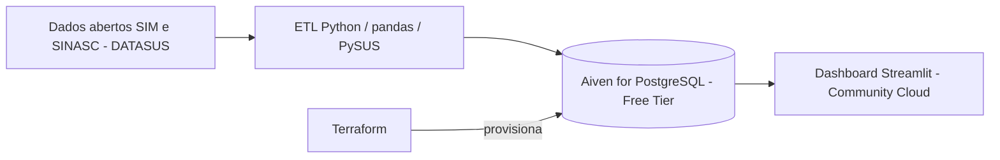

# Painel Epidemiológico de Mortalidade Materna e Desigualdade Racial

Projeto prático de Computação em Nuvem / Engenharia de Software (ODS 5 e ODS 18).
**Grupo 2:** Raul Bastos, João Gabriel, Filipe Araujo, Levi Silva.

**Dashboard online:** Mortalidade Materna e Desigualdade Racial · Streamlit

## 1. Objetivo

Pipeline de dados em nuvem a custo zero que cruza **gênero e raça/cor** para mostrar desigualdades na mortalidade materna e na assistência ao parto, usando microdados públicos do SIM e do SINASC (Ministério da Saúde).

Recorte atual: **BA, SP, PA e RS**, anos **2015 a 2022**.

## 2. Arquitetura



- **Fonte:** SIM (óbitos) e SINASC (nascidos vivos), arquivos por UF e ano.
- **ETL:** `etl/etl.py` baixa os arquivos, trata códigos ausentes, converte tipos e **agrega** por ano, UF e raça/cor da mãe antes de carregar (respeita o limite de 1 GB).
- **Banco:** PostgreSQL gratuito da Aiven, criado por **Terraform** (`terraform/`).
- **Dashboard:** `dashboard/app.py` (Streamlit + Plotly), com filtros de UF, período e raça/cor.

## 3. Estrutura do repositório

```
terraform/   provider.tf, variables.tf, service.tf, outputs.tf
sql/         schema.sql (tabelas agregadas e view de indicadores)
etl/         etl.py (carga), explorar.py (conferência das colunas)
dashboard/   app.py
requirements.txt
```

## 4. Dicionário de variáveis

### Variáveis de origem

| Base | Campo | Descrição | Tipo de destino |
|---|---|---|---|
| SIM | DTOBITO | Data do óbito | DATE |
| SIM | CAUSABAS | Causa básica (CID-10) | VARCHAR(4) |
| SIM | OBITOGRAV | Óbito na gravidez, parto ou aborto | SMALLINT |
| SIM | OBITOPUERP | Óbito no puerpério | SMALLINT |
| SIM | RACACOR | Raça/cor | SMALLINT |
| SIM | CODMUNRES | Município de residência | VARCHAR(6) |
| SINASC | DTNASC | Data de nascimento | DATE |
| SINASC | RACACORMAE | Raça/cor da mãe | SMALLINT |
| SINASC | PARTO | Tipo de parto (1 vaginal, 2 cesáreo) | SMALLINT |
| SINASC | CONSULTAS | Faixa de consultas de pré-natal (1 nenhuma, 2 de 1 a 3, 3 de 4 a 6, 4 de 7 ou mais, 9 ignorado) | SMALLINT |
| SINASC | CODMUNRES | Município de residência da mãe | VARCHAR(6) |

Raça/cor: 1 Branca, 2 Preta, 3 Amarela, 4 Parda, 5 Indígena; em branco ou ignorado vira a categoria **Ignorado** (não é descartado nem imputado).

### Tabelas no PostgreSQL

**obitos_maternos_agg**: `ano` SMALLINT, `uf` CHAR(2), `raca_cor` VARCHAR(20), `obitos_maternos` INTEGER.

**nascidos_vivos_agg**: `ano` SMALLINT, `uf` CHAR(2), `raca_cor` VARCHAR(20), `nascidos_vivos` INTEGER, `partos_cesareos` INTEGER, `prenatal_insuficiente` INTEGER.

**View indicadores**: `razao_mortalidade` (óbitos por 100 mil nascidos vivos), `pct_cesarea`, `pct_prenatal_insuficiente` (menos de 7 consultas), todos NUMERIC.

## 5. Critério de óbito materno

Causa básica do capítulo O da CID-10 (exceto O96 e O97), mais causas maternas fora do capítulo O quando o óbito ocorreu na gravidez ou no puerpério (campos OBITOGRAV e OBITOPUERP). O critério segue a vigilância do óbito materno do Ministério da Saúde.

## 6. Como reproduzir

Pré-requisitos: Python 3, Terraform, Git, conta gratuita na Aiven.

1. **Token da Aiven:** gerar no console e **não** colocar em arquivo versionado.
2. **Infraestrutura:**

```powershell
cd terraform
$env:TF_VAR_aiven_api_token = "SEU_TOKEN"
$env:TF_VAR_project_name = "NOME_DO_PROJETO_AIVEN"
terraform init
terraform apply
$env:DB_URI = terraform output -raw postgresql_service_uri
cd ..
```

3. **Dependências:** `pip install -r requirements.txt` e `pip install pysus`.
4. **Tabelas:**

```powershell
python -c "import os, psycopg2; c=psycopg2.connect(os.environ['DB_URI']); cur=c.cursor(); cur.execute(open('sql/schema.sql', encoding='utf-8-sig').read()); c.commit()"
```

5. **Carga:** `python etl\etl.py` (a primeira execução baixa os arquivos e demora).
6. **Dashboard local:** `python -m streamlit run dashboard\app.py`.
7. **Dashboard online:** Streamlit Community Cloud apontando para `dashboard/app.py`, com o segredo `DB_URI` cadastrado em *Secrets*.

Segurança: nenhum token ou senha está no repositório. `.tfstate` e `.tfvars` estão no `.gitignore`.

## 7. Limitações

- **Violência obstétrica não é medida diretamente.** SIM e SINASC não registram esse fenômeno; usamos indicadores indiretos (proporção de cesáreas e de pré-natal insuficiente por raça/cor).
- **Raça/cor ignorada** varia entre SIM e SINASC; por isso a razão da categoria "Ignorado" é instável e deve ser lida com cautela.
- **Eventos raros:** com poucos óbitos por categoria, a razão oscila muito entre anos. O dashboard mostra o número absoluto de óbitos junto da razão.
- **2022 é preliminar** no SIM.
- Recorte de 4 UFs, para respeitar o limite de 1 GB e o tempo de carga.


